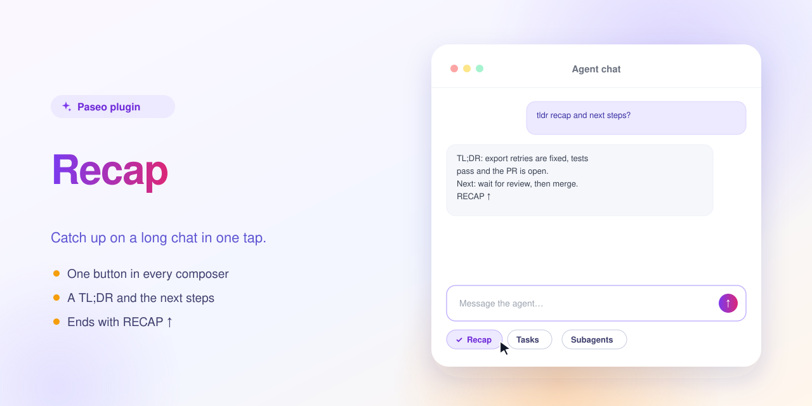
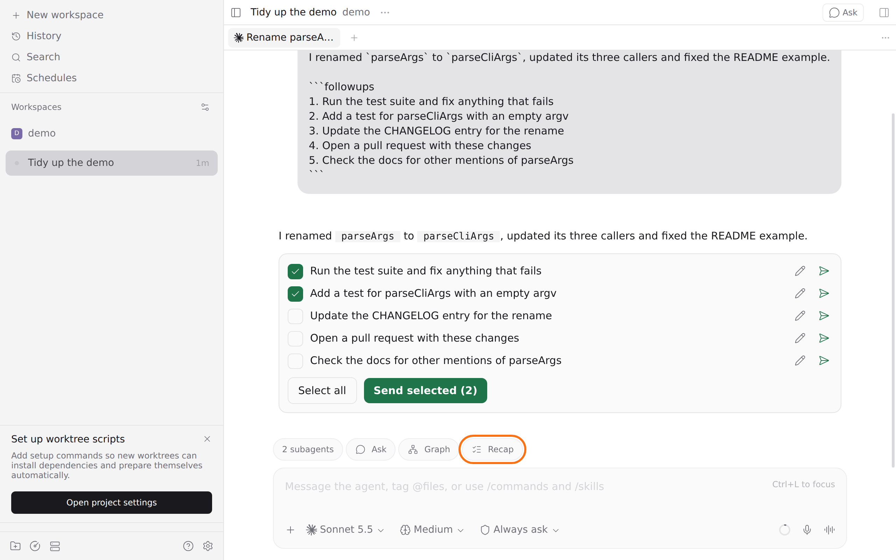

<p align="center"></p>

# Recap — a Paseo plugin



Adds a Recap button to every agent's composer. Pressing it sends "tldr recap and next steps?" to that agent and asks it to end the answer with "RECAP ↑", so you can catch up on a long chat in one tap.



The prompt goes to the agent like any message you type. There are no settings and no daemon code.

The button shows only in chats with an existing agent, because Paseo does not draw plugin pills in a new-agent draft.

## Install

Requires Paseo 0.15.2 or later.

```bash
paseo plugin install https://github.com/puchkoff/paseo-recap
```

Or from a local clone: `paseo plugin install ./paseo-recap`. Check with `paseo plugin ls`.

## Develop

```bash
npm install
npm run typecheck
```

The in-app description shown by Paseo lives in [OVERVIEW.md](OVERVIEW.md).
